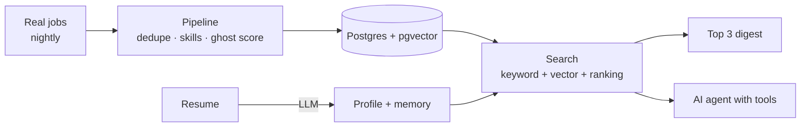

# JobPilot : AI job-matching agent

Paste your resume → get matched to real jobs → see your **top 3 jobs for today** → chat with an **AI agent that remembers your preferences**.

**Live demo:** https://YOUR-APP.onrender.com
**Stack:** Python · FastAPI · PostgreSQL + pgvector · Gemini (LLM + embeddings) · Docker · Render · GitHub Actions

## Features

- **Resume → profile:** the LLM turns your resume into structured JSON (skills, roles, experience), validated with Pydantic.
- **Semantic job search:** Gemini embeddings + pgvector, combined with keyword search, then personalised ranking with reasons ("Matches 4/6 skills", "Remote").
- **Top 3 today:** the LLM picks and explains your 3 best jobs. Every job id is checked, so it can't invent jobs.
- **AI agent:** calls 5 tools (search, job details, save preferences, save job, saved jobs) and remembers past chats and preferences.
- **Live jobs index:** a nightly pipeline pulls real jobs, removes duplicates, re-embeds only changed jobs and flags stale "ghost" listings.
- **Reliable:** falls back to simpler non-AI methods if the AI is down; rate limiting; health check; 31 tests in CI.

## How it works



## Results

**Search quality** (20 labelled queries, nDCG@10, higher is better):

| | Keyword | Embeddings | Hybrid |
|---|---|---|---|
| All queries | 0.73 | **0.98** | 0.90 |
| Paraphrased queries | 0.49 | **0.96** | 0.80 |

**AI quality:**
- Resume parsing: skill F1 **0.88**, 100% valid JSON on the first try
- Top-3 digest: **100%** grounded (no invented jobs)
- Agent: picked the right tool **3/3** times and remembered preferences

## Run locally

Needs Python 3.11+, a free [Neon](https://neon.tech) database and a free [Gemini API key](https://aistudio.google.com).

```bash
python -m venv .venv
.venv\Scripts\activate                 # Mac/Linux: source .venv/bin/activate
pip install -r requirements-dev.txt
copy .env.example .env                 # then add your keys
python -m scripts.manage init-db
python -m scripts.manage seed --n 300
python -m scripts.manage ingest-remotive --limit 50
python run.py                          # open http://127.0.0.1:8000
```

**Tests:** `pytest` · **Evals:** `python -m evals.retrieval_eval` and `python -m evals.llm_eval`

## Project structure

```
jobpilot/
├── jobpilot/        # code: api, agent, llm, search, ingest, services, db, schemas, utils
├── static/          # web page (HTML, CSS, JS)
├── scripts/         # command-line tasks (init-db, seed, ingest)
├── evals/           # search + AI quality tests
├── tests/           # automated tests
├── docs/            # architecture notes
└── run.py           # starts the app
```

## Design choices

- **No LangChain:** the agent is a ~100-line loop over direct API calls, so it's easy to debug and works with any OpenAI-compatible model.
- **AI only where it adds value:** jobs are processed without an LLM, so the index can scale; the LLM is used per user (resume, top 3, chat).
- **Never trust raw AI output:** everything is validated; on failure the app falls back instead of breaking.

More detail: [docs/ARCHITECTURE.md](docs/ARCHITECTURE.md)

---
Real jobs come from the [Remotive API](https://github.com/remotive-com/remote-jobs-api). Jobs marked "demo" are synthetic test data. MIT License.